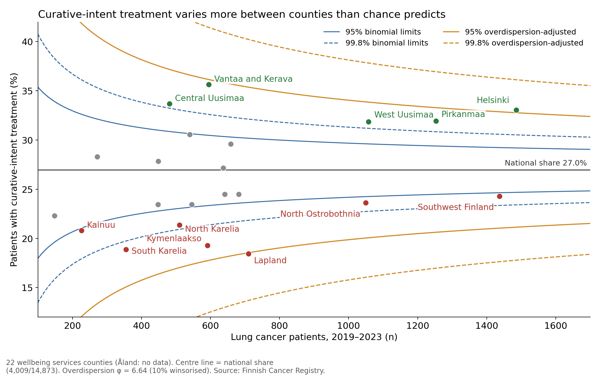

The differences between counties are much larger than chance would produce. Once that extra variation is allowed for, only Lapland (low) and Helsinki (high) stand out, and both only just. The overall picture is a gradient, not a few isolated outliers: Helsinki, the Uusimaa counties and Pirkanmaa are high, and the eastern and northern counties are low.

**Rows used.** I used the 22 county rows: 01–21 and Helsinki (90). Patient and curative-intent counts are the registry counts exactly as given, so nothing was derived. Patient numbers equal `lung_cases_5y_n` in every row, and each count divided by patients reproduces the published share to within ±0.05 percentage points.
- **Åland is excluded.** All its lung cancer fields are empty, and its count can't be derived because both the share and the case count are missing.
- **Centre line.** The national share is 4,009 / 14,873 = 26.95 %.
- **Totals don't match exactly.** The 22 counties add up to 14,774 patients and 3,992 treatments, which is 99 patients and 17 treatments short of the national row. The table doesn't say where the remainder belongs.

**Is the variation more than chance?** Yes.
- **Heterogeneity test:** χ² = 187.7 on 21 degrees of freedom, p ≈ 1e-28.
- **Overdispersion:** the variance between counties is about 6.6 times what chance alone predicts (φ = 6.64, z-scores trimmed at 10 %).
- **Random-effects model:** the between-county SD is 4.9 percentage points and I² = 0.89, meaning most of the spread is systematic.

**Outliers.** Against plain binomial limits, 12 of 22 counties fall outside the 95 % limits:

| County | Patients | Curative-intent | Share | Exact p | Outside | Patients/yr vs national share |
|---|---|---|---|---|---|---|
| Lapland | 710 | 131 | 18.5 % | 1.4e-07 | below 99.8 % | 12.1 fewer |
| South Karelia | 355 | 67 | 18.9 % | 0.0005 | below 99.8 % | 5.7 fewer |
| Kymenlaakso | 591 | 114 | 19.3 % | 1.6e-05 | below 99.8 % | 9.1 fewer |
| Kainuu | 226 | 47 | 20.8 % | 0.036 | below 95 % | 2.8 fewer |
| North Karelia | 510 | 109 | 21.4 % | 0.0044 | below 95 % | 5.7 fewer |
| North Ostrobothnia | 1050 | 248 | 23.6 % | 0.015 | below 95 % | 7.0 fewer |
| Southwest Finland | 1437 | 349 | 24.3 % | 0.022 | below 95 % | 7.7 fewer |
| West Uusimaa | 1058 | 337 | 31.9 % | 0.00041 | above 99.8 % | 10.4 more |
| Pirkanmaa | 1253 | 400 | 31.9 % | 0.0001 | above 99.8 % | 12.5 more |
| Helsinki | 1486 | 491 | 33.0 % | 2.2e-07 | above 99.8 % | 18.1 more |
| Central Uusimaa | 481 | 162 | 33.7 % | 0.0012 | above 99.8 % | 6.5 more |
| Vantaa and Kerava | 595 | 212 | 35.6 % | 3.6e-06 | above 99.8 % | 10.3 more |

With the overdispersion-adjusted limits, only Lapland (z = −1.98) and Helsinki (z = 2.05) are outside 95 %, and no county is outside 99.8 %. Under a random-effects model, no county is outside 95 %. With 22 counties tested at 95 %, about one false flag is expected by chance anyway.

**Exploratory correlations (22 counties; Spearman ρ with 95 % CIs).** These are ecological associations between areas, not causes. The characteristics also go together: older, less educated and more remote counties are largely the same ones, and 22 data points can't separate them.

| Characteristic | ρ | 95 % CI |
|---|---|---|
| Population aged 65+ | −0.77 | −0.91 to −0.47 |
| Distance to university hospital | −0.67 | −0.86 to −0.30 |
| Lung cancer incidence | −0.62 | −0.84 to −0.24 |
| Education level index | 0.49 | 0.06 to 0.77 |
| Daily smoking | −0.30 | −0.65 to 0.15 |

The 95 % CIs are Fisher intervals; bootstrap intervals (5,000 resamples) are similar and are in the summary. There is no correction for multiple testing.

**Limits.**
- **Recording, not just treatment.** The registry says stage is recorded for only about half of patients, and recording practice differs by county. The shares are not adjusted for stage, so part of the difference may reflect recording rather than treatment.
- **Missing treatment records.** The share of patients with no treatment record also varies widely, from 16 % to 43 %; Southwest Finland and South Karelia are above 40 %. Missing records would lower the measured share.
- **Pooled period.** The five years are pooled, so trends can't be examined.

Files are in the output tray:
- county_table_input.csv: your input table, saved unchanged.
- county_curative_intent_table.csv: the county table with limits, z-scores, p-values and patients-per-year gaps.
- ecological_correlations.csv: the correlation table.
- funnel_plot_curative_intent.png: the funnel plot, sized for a slide.
- funnel_analysis.py: the full analysis script.

[results_summary.md](artifacts/results_summary.md) — the Markdown results summary, with the full outlier table, correlations and limitations.
