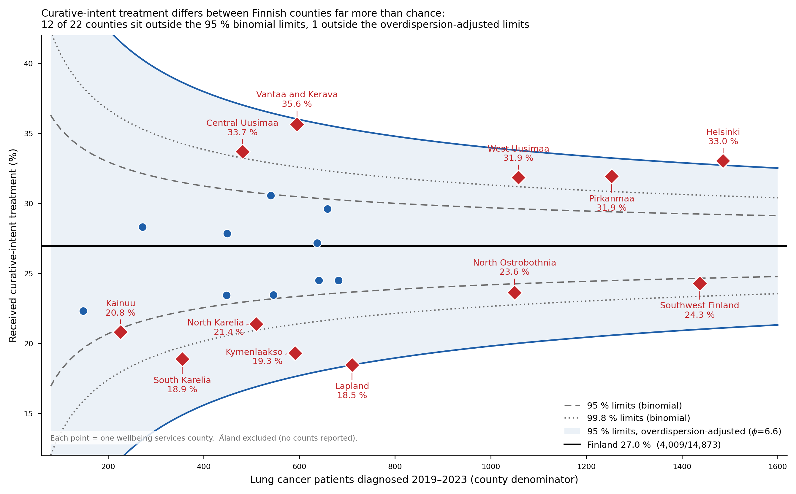

**Yes — the between-county differences are far larger than chance.** Homogeneity test on the 22 counties with counts: Q = 187.7 on 21 df, p ≈ 10⁻²⁸, dispersion factor φ = 8.5 (winsorised 6.6), between-county SD τ = 4.9 pp. Shares run 18.5 % → 35.6 % around a national 27.0 %.

**Rows used.** All 22 counties that carry both counts (`area_id` 01–21, 90). Åland (`area_id` 91) has patients, curative-intent count, share and case count all empty — nothing is derivable, so it is excluded everywhere, including the correlations. **No count had to be derived from share × case count:** `lung_cases_5y_n` equals `lung_patients_2019_2023_n` for all 22, and the recomputed shares reproduce the reported ones to ≤0.05 pp. The Finland row is used only as the centre line (4,009/14,873 = 26.95 %). The 22 counties sum to 14,774 patients and 3,992 treatments, so 99 patients and 17 treatments sit in the national total but in no county row; using the 22-county sum (27.02 %) as the centre line instead leaves the set of flagged counties unchanged.

**Outliers (exact two-sided binomial vs 26.95 %, BH q across 22 tests).**

| Above | n | treated | share | p | q |
|---|---:|---:|---:|---:|---:|
| Vantaa and Kerava | 595 | 212 | 35.6 % | 3.6e-06 | 2.6e-05 |
| Central Uusimaa | 481 | 162 | 33.7 % | 0.0012 | 0.0033 |
| Helsinki | 1,486 | 491 | 33.0 % | 2.2e-07 | 2.4e-06 |
| Pirkanmaa | 1,253 | 400 | 31.9 % | 1.0e-04 | 4.4e-04 |
| West Uusimaa | 1,058 | 337 | 31.9 % | 4.1e-04 | 0.0015 |

| Below | n | treated | share | p | q | shortfall, patients/yr |
|---|---:|---:|---:|---:|---:|---:|
| Lapland | 710 | 131 | 18.5 % | 1.4e-07 | 2.4e-06 | 12.1 |
| South Karelia | 355 | 67 | 18.9 % | 5.0e-04 | 0.0016 | 5.7 |
| Kymenlaakso | 591 | 114 | 19.3 % | 1.6e-05 | 8.6e-05 | 9.1 |
| Kainuu | 226 | 47 | 20.8 % | 0.0359 | 0.0659 | 2.8 |
| North Karelia | 510 | 109 | 21.4 % | 0.0044 | 0.0107 | 5.7 |
| North Ostrobothnia | 1,050 | 248 | 23.6 % | 0.0149 | 0.0327 | 7.0 |
| Southwest Finland | 1,437 | 349 | 24.3 % | 0.0221 | 0.0442 | 7.7 |

All five high counties and Lapland, South Karelia, Kymenlaakso are outside the 99.8 % limits; the other four low counties are between the 95 % and 99.8 % limits, and Kainuu is the only one that loses significance after FDR adjustment (q = 0.066). Together the seven low counties are about **50 patients a year** short of the national share.

With limits inflated by √φ = 2.58, only Helsinki stays outside — the adjusted limits absorb the county-level spread into the null, so they test "unusual *given* that counties differ this much", not whether the counties differ. Vantaa and Kerava has the highest share but falls inside the adjusted band because its denominator is smaller than Helsinki's.

**Rank correlations (exploratory, n = 22, Spearman with Bonett–Wright CIs):** 65+ share ρ = −0.77 (−0.91, −0.47); distance to university hospital −0.66 (−0.86, −0.30); lung cancer incidence −0.62 (−0.84, −0.24); education index +0.49 (+0.06, +0.77); daily smoking −0.30 (−0.65, +0.15). These are ecological associations between county aggregates, not causes — the five variables are strongly intercorrelated, the CIs are wide at 22 units, and none of this identifies an effect on an individual patient's chance of curative-intent treatment.

**Limits.** The registry reports stage for roughly half of lung cancer patients with county-varying recording practice, so part of the spread is documentation rather than care. The `lung_no_treatment_record_pct` column supports that reading: it ranges 16.4 % to 43.1 %, and Southwest Finland (43.1 %) and South Karelia (42.8 %), both low-share counties, hold the two highest values. There is no case-mix adjustment available (no stage, performance status, histology or comorbidity in the table), cross-county referral to university hospitals can move counts between neighbours, and the five pooled years span COVID-19 with no annual breakdown. Full caveats are in §5 of the summary.

- [results_summary.md](artifacts/results_summary.md) — results write-up with all tables and caveats
- [county_table_analysis.csv](artifacts/county_table_analysis.csv) — per-county counts, shares, exact CIs, p/q, both limit bands, per-year gap
- [lung_curative_funnel.py](artifacts/lung_curative_funnel.py) — full analysis script
- [rank_correlations.csv](artifacts/rank_correlations.csv) — Spearman ρ, CIs, p
- [county_table_input.csv](artifacts/county_table_input.csv) — input table as supplied