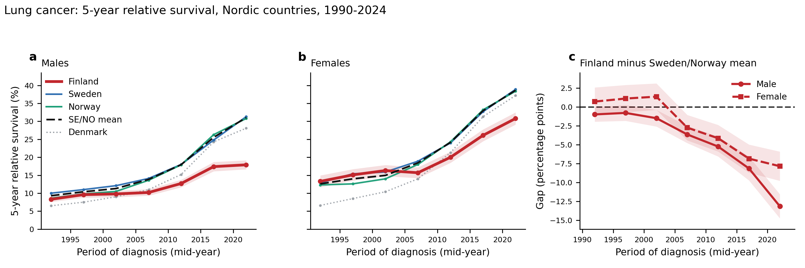
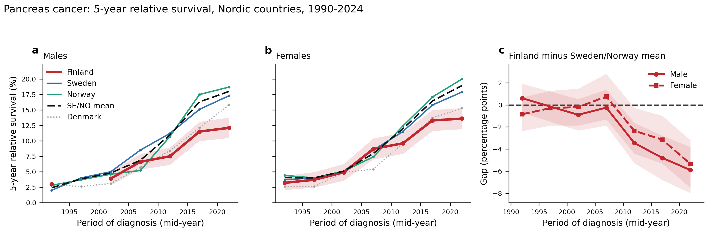
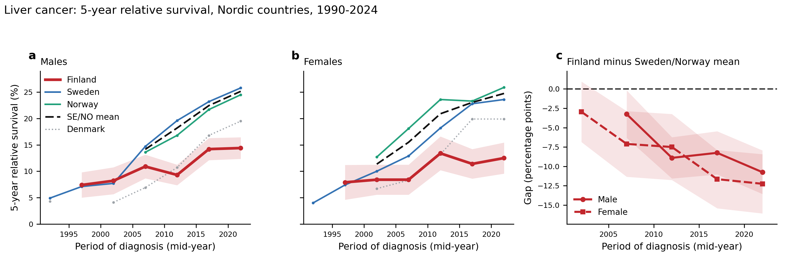

All numbers below come from the six live API responses (6/6 HTTP 200, empty `error` arrays, 197 records total).

## Where Finland stands, 2020–2024 (5-year relative survival, %)

| Cancer | Sex | Finland | Sweden | Norway | SE/NO mean | Gap (pp, 95% CI) | Gap change per decade (pp, 95% CI) | Finland lags |
|---|---|---|---|---|---|---|---|
| Lung | Male | 17.9 | 31.3 | 30.8 | 31.05 | **−13.15** (−14.74, −11.56) | −3.92 (−5.67, −2.17), p=0.002 | 10.1 y |
| Lung | Female | 30.8 | 38.9 | 38.4 | 38.65 | **−7.85** (−9.78, −5.92) | −3.36 (−4.68, −2.05), p=0.001 | 6.2 y |
| Pancreas | Male | 12.1 | 17.3 | 18.7 | 18.00 | **−5.90** (−7.98, −3.82) | −2.29 (−3.49, −1.10), p=0.006 | 8.9 y |
| Pancreas | Female | 13.6 | 17.9 | 20.0 | 18.95 | **−5.35** (−7.51, −3.19) | −1.53 (−2.93, −0.12), p=0.039 | 8.2 y |
| Liver | Male | 14.4 | 25.8 | 24.5 | 25.15 | **−10.75** (−13.57, −7.93) | −4.37 (−11.54, +2.80), p=0.12 | 14.7 y |
| Liver | Female | 12.5 | 23.6 | 25.9 | 24.75 | **−12.25** (−16.08, −8.42) | −4.63 (−6.94, −2.32), p=0.008 | 18.6 y |

Denmark (shown in the figures for context) is between Finland and the SE/NO mean in every one of the six latest-period series.

**The gap is not a stalled Finland — it is a slower Finland.** Finnish survival rose in all six series (e.g. lung males +3.4 pp/decade, lung females +5.6, pancreas males +3.3, liver males +2.9). The Sweden/Norway benchmark rose faster in all six (lung males +7.3, lung females +8.9, pancreas males +5.6, liver males +7.5 pp/decade), so the gap widened. Lung and pancreas gaps were near zero in the 1990s — Finnish women with lung cancer were *above* the benchmark through 2000–2004 (+1.4 pp) — and opened after about 2005. The liver-male gap trend is the one estimate not distinguishable from no change (CI spans zero, 4 periods only).

**Lag** is the number of calendar years ago that the SE/NO mean curve passed Finland's current value, by linear interpolation between period mid-years: Finland's 2020–2024 lung-male survival (17.9%) sits between the benchmark's 13.85% in 2007 and 17.95% in 2012.

## Limits of these data

1. **Coverage is incomplete for liver.** Eleven country × sex × period cells are absent from the API in 1990–2024, ten of them liver: Norway has no liver estimate before 2005–2009 (males) or 2000–2004 (females), Denmark none for 1995–1999, Finland none for 1990–1994. The liver benchmark therefore begins at 2000–2004 (females) / 2005–2009 (males), and the liver trend uses 5 and 4 periods respectively rather than 7. Finland's 1995–1999 pancreas-male estimate is also absent. Nothing was imputed; these cells are empty in the outputs.
2. **The latest period may rest on partial follow-up.** The API labels the last band 2020–2024 even though `year_end=2023` was requested, and the response carries no field stating the follow-up cut-off or the estimation method (cohort, period or hybrid). The 2020–2024 figures should be read as provisional.
3. **What `age_surv=0` returns is not documented in the response.** It yields one value per period (vs. five age-specific rows for `age_surv=1/2`), so it is the all-ages series, but the payload contains no flag saying whether it is age-standardised or crude. If crude, part of the Finland–Sweden/Norway difference could reflect age structure at diagnosis rather than survival itself.
4. **The benchmark is an unweighted mean** of the two national estimates, matching the "Sweden/Norway average" wording of the strategy target; it is not population-weighted, so Norway (smaller) counts equally with Sweden.
5. **Gap confidence intervals are derived, not supplied.** The API gives 95% CIs per country only; gap CIs were computed from those, assuming normality and independence between countries. Trend slopes are ordinary least squares on period mid-years, which treats each period estimate as equally precise.
6. **Lag has ±2.5-year granularity** from the 5-year period grid, and assumes the benchmark rose monotonically. For liver the crossing falls inside the first available benchmark interval, so those two values are especially sensitive to where the series begins.
7. **Relative survival is not treatment quality alone.** Case counts, stage distribution and registration practice are not returned by this endpoint, so differences in early detection, lead time and death-certificate-only handling cannot be separated from differences in care — the direct implication for a strategy targeting these three sites.

Artifacts:
- [nordcan_gap_summary.csv](artifacts/nordcan_gap_summary.csv) — the results table above, with full precision, p-values, periods used and lag provenance
- [nordcan_survival_1990_2024.csv](artifacts/nordcan_survival_1990_2024.csv) — per cancer × sex × period: all four countries, benchmark, gap with CI
- [nordcan_survival_long_all_periods.csv](artifacts/nordcan_survival_long_all_periods.csv) — tidy long form including the pre-1990 periods the API returned
- [nordcan_survival_analysis.py](artifacts/nordcan_survival_analysis.py) — full script; set `OFFLINE = True` to re-run from the saved payloads
- [nordcan_raw_api.tar.gz](artifacts/nordcan_raw_api.tar.gz) and [nordcan_api_manifest.json](artifacts/nordcan_api_manifest.json) — the six raw JSON responses with URLs, record counts and SHA-256 checksums

One note on access: `canapi.iarc.who.int` was not on the sandbox allowlist, so the fetch required a one-time domain grant, which you approved; the data are live from that host, not from any mirror.