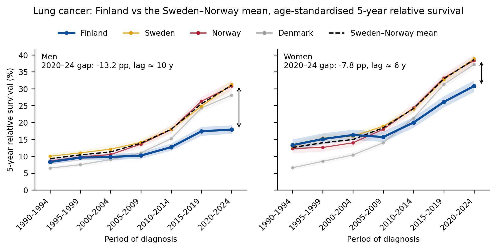
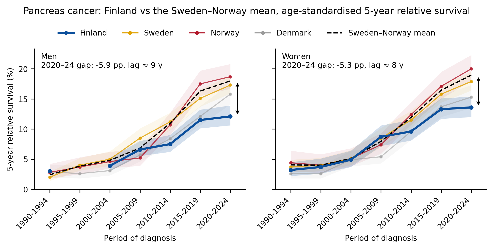
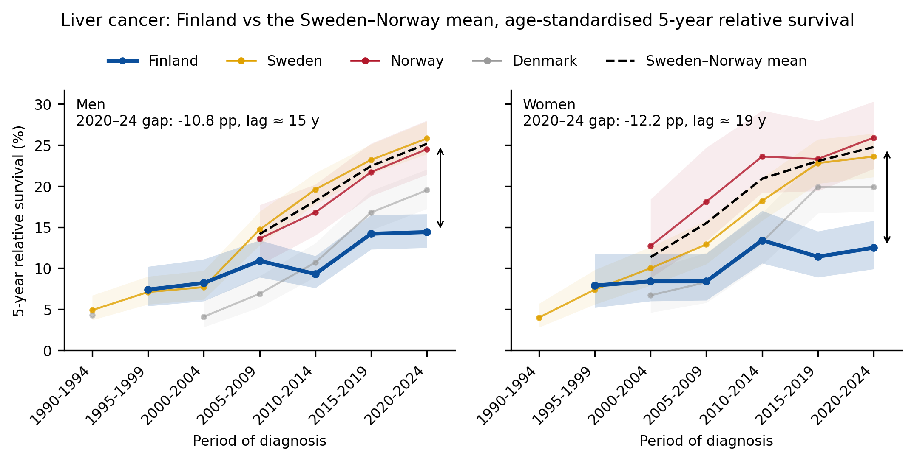

For all six cancer–sex groups, Finland's 5-year relative survival in 2020–2024 is 5–13 percentage points (pp) below the Sweden–Norway mean. Finland trails that mean by roughly 6–19 years. Since 1990 the gap has widened in every decade the data cover. All data were fetched live from the API, release 961, using the parameters you gave. Every API call returned an empty `error` field.

## Results (2020–2024, age-standardised 5-year relative survival, %)

| Cancer | Sex | Finland | Sweden | Norway | SE/NO mean | Gap (pp, approx. 95% CI) | Finland as % of mean | Lag (years) |
|---|---|---|---|---|---|---|---|---|
| Lung | Men | 17.9 | 31.3 | 30.8 | 31.05 | −13.2 (−14.7 to −11.6) | 57.6 | 10.1 |
| Lung | Women | 30.8 | 38.9 | 38.4 | 38.65 | −7.9 (−9.8 to −5.9) | 79.7 | 6.2 |
| Pancreas | Men | 12.1 | 17.3 | 18.7 | 18.00 | −5.9 (−8.0 to −3.8) | 67.2 | 8.9 |
| Pancreas | Women | 13.6 | 17.9 | 20.0 | 18.95 | −5.4 (−7.5 to −3.2) | 71.8 | 8.2 |
| Liver | Men | 14.4 | 25.8 | 24.5 | 25.15 | −10.8 (−13.6 to −7.9) | 57.3 | 14.7 |
| Liver | Women | 12.5 | 23.6 | 25.9 | 24.75 | −12.3 (−16.1 to −8.4) | 50.5 | 18.6 |

**How the gap changed (Finland minus the SE/NO mean, in pp, at the start of each decade):**

| Cancer | Sex | 1990–94 | 2000–04 | 2010–14 | 2020–24 | Trend (pp per decade, linear fit) |
|---|---|---|---|---|---|---|
| Lung | Men | −1.0 | −1.5 | −5.25 | −13.15 | −3.9 |
| Lung | Women | +0.7 | +1.35 | −4.15 | −7.85 | −3.4 |
| Pancreas | Men | +0.6 | −0.9 | −3.45 | −5.9 | −2.3 |
| Pancreas | Women | −0.85 | −0.2 | −2.35 | −5.35 | −1.5 |
| Liver | Men | n/a | n/a | −8.9 | −10.75 | −4.4 (4 periods) |
| Liver | Women | n/a | −2.95 | −7.5 | −12.25 | −4.6 (5 periods) |

- **The gap is new.** In 1990–94 Finland was within about 1 pp of Sweden and Norway for lung and pancreas cancer, and ahead of them for women's lung cancer.
- **Finland improved, but more slowly.** From 1990–94 to 2020–24, men's lung survival rose 9.6 pp in Finland against 21.75 pp for the Sweden–Norway mean. Women's lung survival rose 17.5 pp against 26.05 pp.
- **Lung cancer in men is the widest gap and is still opening fastest:** it grew 7.9 pp between 2010–14 and 2020–24. Finland's own value barely moved (17.4 → 17.9) between 2015–19 and 2020–24.
- **Lag** is the number of years before 2022 (the midpoint of 2020–24) at which the Sweden–Norway mean was at Finland's current level. I read it off a straight line drawn between period midpoints.

## Limits of the data
1. **Missing values for liver cancer.** The API returns nothing for 11 country–period combinations between 1990 and 2024. These include Finnish liver cancer in 1990–94 (both sexes), and Norwegian liver cancer for 1990–2004 in men and 1990–1999 in women. Where either Sweden or Norway is missing, the mean is left undefined; I did not fill these in. As a result, there are no liver gap values before 2005–09 for men or 2000–04 for women. The liver trends rest on 4–5 points. Pancreas cancer in men in Finland is also missing for 1995–99.
2. **The latest period is estimated differently.** NORDCAN uses the cohort approach for 5-year survival in all but the last five-year period, for which the period approach was used. The 2020–24 figure is therefore an up-to-date prediction rather than observed 5-year follow-up. Part of the widening in that period could come from the change of method.
3. **What the numbers measure.** The estimates are age-standardised relative survival estimated using the Pohar Perme estimator, with individual ICSS weights. They are calculated by the API, not by me. The API documentation does not define the path parameter `5` or `age_surv=0`; I used them exactly as you specified.
4. **The year range has no effect.** `year_end=2023` and `year_end=2024` returned identical data: the latest period is always labelled 2020–2024, with midpoint 2022. I could not check from the API how far follow-up actually extends.
5. **Confidence intervals and lag are approximate.**
   - The gap intervals assume symmetric, independent errors. NORDCAN's intervals are asymmetric, so the error was approximated as the CI width divided by 3.92.
   - The lag uses straight lines between 5-year points, so it is precise to a few years at best. For liver cancer it depends on 2–3 noisy points: Norway's liver CIs are 8–15 pp wide.
6. **Not adjusted for stage or case mix.** Relative survival does not account for stage at diagnosis or tumour type. The gaps may partly reflect differences in diagnosis, registration or coding between the countries rather than outcomes alone.

## Files
- [nordcan_finland_gap_results.csv](artifacts/nordcan_finland_gap_results.csv) — the results table
- [nordcan_survival_gap.py](artifacts/nordcan_survival_gap.py) — the full analysis script. Running it with `--offline` re-runs everything from the saved raw files; I checked that it reproduces the results table exactly.
- [nordcan_surv5_long.csv](artifacts/nordcan_surv5_long.csv) — every value returned by the API, flattened into one table
- Raw API responses, saved with their request URLs, one per cancer and sex:
  - Lung: [men](artifacts/nordcan_surv5_cancer160_sex1_1973_2024.json), [women](artifacts/nordcan_surv5_cancer160_sex2_1973_2024.json)
  - Pancreas: [men](artifacts/nordcan_surv5_cancer130_sex1_1973_2024.json), [women](artifacts/nordcan_surv5_cancer130_sex2_1973_2024.json)
  - Liver: [men](artifacts/nordcan_surv5_cancer110_sex1_1973_2024.json), [women](artifacts/nordcan_surv5_cancer110_sex2_1973_2024.json)

---

**Correction after the app's own review of this answer:**

Correct: the "widened in every decade" claim was wrong for 1990–94 to 2000–04. Here is the corrected statement, using the values already in the results table:

- **From 2000–04 to 2010–14, and from 2010–14 to 2020–24:** the gap widened in every cancer–sex group with data, by 1.85–7.9 pp per decade.
- **From 1990–94 to 2000–04, the pattern was mixed:**
  - Lung, men: the gap widened slightly (−1.0 → −1.5 pp).
  - Pancreas, men: Finland went from slightly ahead to slightly behind (+0.6 → −0.9 pp).
  - Pancreas, women: the gap narrowed (−0.85 → −0.2 pp).
  - Lung, women: Finland was ahead and its lead grew (+0.7 → +1.35 pp).
  - Liver: no values for this decade.

The results table and figures are unchanged. Only the summary sentence was wrong.
